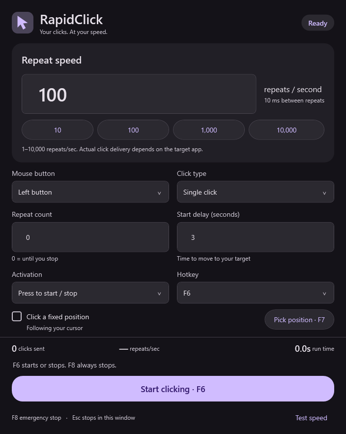

# RapidClick

A fast Windows auto-clicker with a dark, Material-inspired interface. Portable, offline, and built locally. No installer, account, ads, telemetry, or runtime installation.

[Download the latest release](https://github.com/DJProspero1/RapidClick/releases/latest)



## Use

1. Download `RapidClick-1.0.0-win-x64.exe` from Releases and run it on Windows 10/11 x64.
2. Choose a speed, mouse button, and single or double click. Speed is **repeats per second**; a double-click repeat sends two clicks.
3. Press **F6** to start. The default three-second countdown gives you time to move the pointer to the target.
4. Press **F6** again or **F8** to stop. **Esc** stops while the RapidClick window is focused.

Select **Hold hotkey to click** to run only while your chosen key is down. Releasing it also cancels the countdown. The activation key can be changed to F1–F11, except F7/F8, which are reserved for position picking and stopping.

To use a fixed position, move your pointer over the target and press **F7**. Coordinates are physical desktop pixels and support multiple monitors, including displays with negative coordinates. A repeat count of **0** runs until stopped; other counts stop automatically. Settings persist in `%LOCALAPPDATA%\RapidClick\settings.json`.

**Test speed** performs a bounded test inside its own window and compares received clicks with sent clicks. It stops if its window loses focus. No benchmark result guarantees the same speed in a different app.

## Speed and limits

- Configurable from **1 to 10,000 repeats/sec**.
- A dedicated worker uses `Stopwatch` deadlines and Windows high-resolution waitable timers. Small native `SendInput` submissions avoid one UI event per scheduled click.
- Excess scheduling debt is discarded after a long stall; there is no unbounded catch-up burst.
- Each input submission contains complete button-down/button-up pairs. Failed or partial injection stops the run and attempts to release the button.
- F8 and hold-key release are checked on the worker, including during the countdown and long intervals. The UI does not have to process a hotkey message first.
- “Clicks sent” counts input accepted by Windows. Target apps may ignore, merge, or rate-limit simulated clicks. Check `docs/VERIFICATION.md` for measured results and scope.

Windows prevents input into some elevated or protected applications. RapidClick runs with normal user privileges and does not bypass those protections. If a hotkey is already registered by another app, RapidClick reports the conflict. Close and reopen RapidClick after freeing the F8 stop key. The executable is unsigned, so Windows may show an unknown-publisher or SmartScreen notice.

## Build locally

Install the **.NET 10 SDK** on Windows, then run:

```powershell
./scripts/build.ps1
```

Or specify an SDK location:

```powershell
./scripts/build.ps1 -DotnetPath 'C:\path\to\dotnet.exe'
```

This builds the source, runs deterministic behavioral checks, publishes a self-contained single executable, smoke-tests that packaged executable, and creates the EXE, ZIP, and SHA-256 manifest in `artifacts/release/`. All compilation and packaging happen on the local machine; there are no GitHub Actions or cloud builds.

To include actual mouse-injection tests, run `./scripts/build.ps1 -NativeTests`. These open a dedicated target window and move the pointer temporarily. Do not interact with the desktop during the test. The fixture stops injection if it loses foreground focus and restores the pointer afterwards.

## Source map

| Path | Purpose |
| --- | --- |
| `src/RapidClick.Core` | Validated settings, worker, timer, and Win32 input |
| `src/RapidClick` | WPF interface, global hotkeys, settings, safe speed-test window |
| `tests/RapidClick.Tests` | Scheduling, cancellation, exact counts, and native delivery checks |
| `scripts/build.ps1` | Local build, verification, and packaging |
| `docs/VERIFICATION.md` | Release test evidence and limitations |

Built with WPF and the .NET base class library, without third-party runtime packages. MIT licensed. RapidClick is an independent project and is not affiliated with Google.
